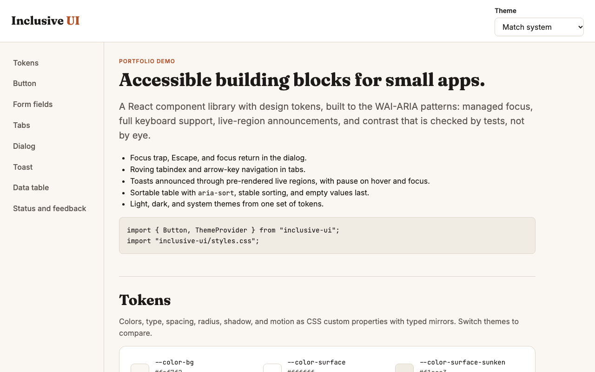
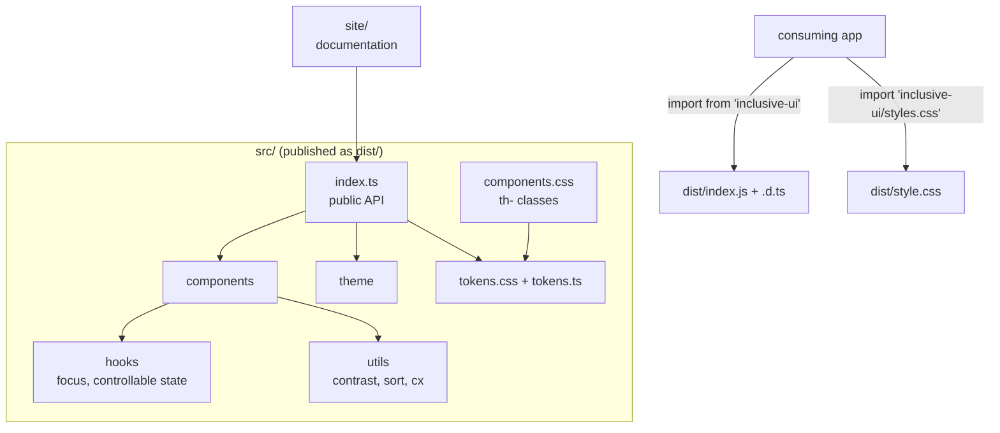

# Inclusive UI

An accessible React component library for a fictional group of makerspace apps: dialogs, tabs, tables, toasts, and form fields that work by keyboard and screen reader out of the box, with tested design tokens and a live documentation site.

[](https://github.com/Nawfaldev19/react-inclusive-ui/actions/workflows/ci.yml)
[](LICENSE)



*The documentation site's opening view. Every example on the site is a live component.*

## Why it exists

Inclusive UI is built for a fictional group of makerspaces that runs several small web apps. Each app needs the same controls, and the hard parts of those controls are invisible in a screenshot: where focus goes when a dialog opens and closes, which arrow keys move between tabs, whether a screen reader hears a toast at all. This library solves those once, behind small typed APIs, and backs the claims with tests rather than documentation alone. It is packaged as a standalone library; the other makerspace demos in this portfolio currently carry their own styles and do not depend on it.

## Key features

- **Keyboard users never lose their place in a dialog.** Focus moves in, Tab and Shift+Tab stay inside (counting only controls that are visible and enabled), Escape closes, focus returns to the opener, the rest of the page is `inert`, and page scroll is locked. See [`Dialog.tsx`](src/components/Dialog.tsx) and its [tests](src/components/Dialog.test.tsx).
- **Tabs and tables follow the WAI-ARIA patterns.** Tabs use a roving tabindex with arrow keys, Home/End, and disabled-tab skipping, and fall back to the first enabled tab if the selected one is missing or disabled, so the list is always reachable; the data table exposes `aria-sort`. See [`Tabs.tsx`](src/components/Tabs.tsx) and [`DataTable.tsx`](src/components/DataTable.tsx).
- **Screen readers announce every toast.** Live regions exist before any toast appears, only errors are assertive, and timers pause on hover or focus. See [`Toast.tsx`](src/components/Toast.tsx).
- **A palette change that breaks contrast fails CI.** CSS custom properties are mirrored as typed constants, a test fails if they drift, and another computes WCAG contrast for every color pair the components render, in both themes. See [`tokens.test.ts`](src/tokens/tokens.test.ts) and [`contrast.ts`](src/utils/contrast.ts).
- **Form fields wire labels, hints, and errors for you.** Controlled and uncontrolled modes, forwarded refs, and generic table columns. See [`Field.tsx`](src/components/Field.tsx) and [`useControllableState.ts`](src/hooks/useControllableState.ts).
- **Installs like a real package.** Tree-shakeable ESM with React as a peer dependency, generated type declarations, one stylesheet, and a script that checks the built package the way a consumer sees it. See [`vite.config.ts`](vite.config.ts) and [`check-package.mjs`](scripts/check-package.mjs).

## Quick start

Requirements: Node.js 20 or newer. No environment variables are needed.

```bash
git clone https://github.com/Nawfaldev19/react-inclusive-ui.git
cd react-inclusive-ui
npm install && npm run dev
```

Open http://localhost:5175 for the documentation site. Try the dialog, tabs, and table using only the keyboard.

### Using the library in an app

```tsx
import { Button, ThemeProvider, ToastProvider, useToast } from "inclusive-ui";
import "inclusive-ui/styles.css";

function SaveButton() {
  const { toast } = useToast();
  return <Button onClick={() => toast({ title: "Saved", tone: "success" })}>Save</Button>;
}

export function App() {
  return (
    <ThemeProvider>
      <ToastProvider>
        <SaveButton />
      </ToastProvider>
    </ThemeProvider>
  );
}
```

The package is not published to a registry. To try it in another project, run `npm run build:lib && npm pack` here and install the generated `.tgz` file there. The full public API is in [`src/index.ts`](src/index.ts).

## Architecture



- **Native first.** `TextField`, `Select`, and `Checkbox` wrap native elements; custom ARIA is used only where HTML has no element (tabs, toasts) or is inconsistent across browsers (modal focus).
- **`Field` wires ids and `aria-describedby`** ("error, then hint") in one place, so every form control behaves the same.
- **Tokens:** `tokens.css` is the source of truth; `tokens.ts` is a typed mirror kept honest by a test. Themes switch with one attribute.
- **The documentation site imports from `src/`** for instant feedback, while `check-package.mjs` verifies the built package separately.

**Key trade-off:** the dialog uses its own focus loop on a portal-rendered `role="dialog"` instead of the native `<dialog>` element. Behavior is identical across browsers and fully unit-testable in jsdom. The cost is that I have to recreate what `showModal()` gives for free: while the dialog is open, every other child of `<body>` gets the `inert` attribute, which is removed again on close ([ADR-003](docs/DECISIONS.md#adr-003-custom-focus-handling-for-the-dialog-instead-of-dialog)). Switching to native `<dialog>` later would mostly delete code.

Component patterns, the dialog focus lifecycle, packaging, and performance: [docs/ARCHITECTURE.md](docs/ARCHITECTURE.md).

## Tech stack

| Choice | Why |
|---|---|
| React 18 + TypeScript (strict) | The target platform; strict mode with unchecked index access catches edge cases in keyboard handling. |
| Plain CSS with custom properties | No runtime styling cost and no styling dependency for consumers; themes switch with one attribute ([ADR-001](docs/DECISIONS.md#adr-001-plain-css-with-custom-properties)). |
| Vite (library mode) | Small ESM output with React kept external; the same tool serves the documentation site. |
| Vitest + Testing Library | Tests interact the way users do: by role, label, and keyboard. |
| Playwright | Confirms focus and keyboard behavior in a real browser, where jsdom cannot (layout, real focus, `inert`). |
| Prettier | One formatting style (120-column lines), checked in CI, so reviews are about behavior rather than layout. |
| Lucide icons (docs site only) | Permissively licensed (ISC). The library itself ships two small hand-drawn SVG icons, so it has no icon dependency. |

## Testing and quality

| Suite | Count | Coverage |
|---|---|---|
| Unit and component (Vitest + Testing Library) | 113 tests | 99% lines, 94% branches, 100% functions |
| Package check ([`check-package.mjs`](scripts/check-package.mjs)) | built `dist/` exports | n/a |
| End to end (Playwright) against the built site | 8 tests | n/a |

Coverage thresholds are enforced (90% lines and functions, 85% branches). [CI](.github/workflows/ci.yml) runs lint, the Prettier check, type checking, tests with coverage, the build, the package check, and `npm pack --dry-run`, then the Playwright suite.

```bash
npm run lint
npm run format:check              # npm run format rewrites files in place
npm run typecheck
npm run test:coverage             # unit and component tests with coverage
npm run build                     # library (dist/) and documentation site (site-dist/)
npm run test:package              # checks the built package's exports
npx playwright install chromium   # once
npm run test:e2e                  # browser tests against the built documentation site
```

Strategy, notable cases, and known gaps: [docs/TESTING.md](docs/TESTING.md).

## Decisions and further docs

- [Decision records](docs/DECISIONS.md): eight ADRs, from plain CSS and native controls to the dialog's focus handling and pre-rendered live regions
- [Architecture](docs/ARCHITECTURE.md): structure, component patterns, tokens, packaging, performance
- [Security](docs/SECURITY.md): what a UI library can and cannot protect against
- [Testing](docs/TESTING.md): strategy, coverage, and known gaps
- [References](docs/REFERENCES.md): specifications and sources
- [Changelog](CHANGELOG.md) and [third-party notices](THIRD_PARTY_NOTICES.md)

## Known limitations and next steps

- **Not published to npm.** Install from a packed tarball or a Git URL.
- **No combobox, menu, date picker, or tooltip.** Each is a large pattern in its own right, and I chose depth on fewer components over breadth; use the native `<select>` and `<input type="date">` instead. A combobox would be the next component.
- **A toast raised while a dialog stays open is not announced.** The toast live regions sit inside the app root, which is `inert` while the dialog is open. Toasts raised by the action that closes the dialog are fine, because `inert` is lifted in the same commit. Next: render the live regions in their own portal next to the dialog.
- **`inert` needs a current browser** (Chrome 102, Firefox 112, Safari 15.5 or later). In older browsers the focus loop still keeps Tab inside, but a screen reader's virtual cursor can reach the background.
- **Right-to-left layouts are not tested.** Tab arrow keys follow left and right literally.
- **No automated accessibility scanner.** The common one is MPL-2.0 licensed, outside this project's permissive-only dependency policy ([ADR-006](docs/DECISIONS.md#adr-006-no-accessibility-scanner-dependency)); see [docs/TESTING.md](docs/TESTING.md) for what is checked instead.
- **No visual regression tests.** Screenshot comparison in Playwright would be the next addition to CI.

## Project status

Complete as a portfolio demo (v1.1.0, see the [changelog](CHANGELOG.md)). Not published or deployed; run the documentation site locally with the quick start above.

<details>
<summary>Recapturing the screenshot</summary>

Run `npm run dev`, open http://localhost:5175 in a 1280 x 800 window in light mode, and save a screenshot of the first screen as `docs/screenshot.png`.

</details>

## Author

Nawfal Imran · [GitHub](https://github.com/Nawfaldev19) · [LinkedIn](https://www.linkedin.com/in/nawfal-imran-886b13218)

## License

[MIT](LICENSE). Third-party licenses are listed in [THIRD_PARTY_NOTICES.md](THIRD_PARTY_NOTICES.md).
