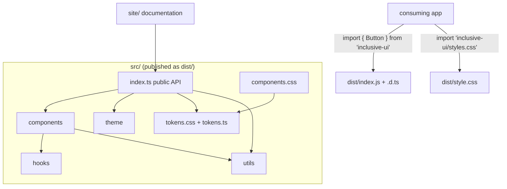
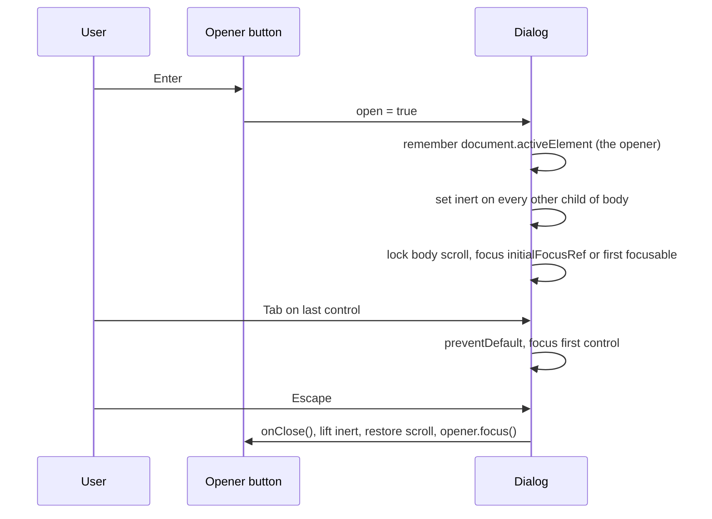

# Architecture

## Layout of the repository

```
src/                    the library (everything here ships, except tests)
  components/           one file per component, test file beside it
  hooks/                focus helpers, controlled/uncontrolled state
  theme/                ThemeProvider and useTheme
  tokens/               tokens.css (source of truth) and tokens.ts (typed mirror)
  styles/               components.css, all classes prefixed th-
  utils/                pure helpers: contrast math, sorting, class names
  index.ts              the public API
site/                   documentation site (imports the library from source)
e2e/                    Playwright tests against the built site
scripts/                package verification
```



## Component patterns

**Native first.** `TextField`, `Select`, and `Checkbox` wrap native elements. Browsers already provide keyboard support, autofill, mobile keyboards, and screen reader semantics for these, and re-implementing them costs accessibility. Custom ARIA is used only where HTML has no element (tabs, toasts) or where the native element is not yet consistent across browsers (modal dialog focus handling).

**Field wiring in one place.** `Field` generates ids and builds `aria-describedby` as "error, then hint", so a screen reader user hears what is wrong before the general advice. Every form control uses it, so the behavior cannot diverge.

**Controlled or uncontrolled.** `Tabs` accepts either `selectedId` + `onSelectedChange` (parent owns the state) or `defaultSelectedId` (component owns it). `useControllableState` implements this once. If the selected id does not match an enabled tab (a typo, a tab that was removed, or a parent selecting a disabled tab), `Tabs` shows the first enabled tab and gives it the tab stop, rather than leaving every tab at `tabIndex=-1`. It does not call `onSelectedChange` for this, because changing a parent's state during render would be surprising.

**Refs where apps need them.** `Button`, `TextField`, `Select`, and `Checkbox` forward refs, so apps can focus a field after a failed submit or pass a button to `Dialog`'s `initialFocusRef`.

### Dialog focus lifecycle



The dialog renders into `document.body` through a portal, so it is never clipped by a parent's `overflow` or stacking context. Being a direct child of `<body>` also makes the background easy to name: it is every other child of `<body>`.

"First focusable" and the ends of the loop come from `focusableWithin`, which starts from a CSS selector and then drops what a browser would skip: disabled controls (including inside a disabled `<fieldset>`), anything under `hidden` or `inert`, and anything hidden by `display: none` or `visibility: hidden`. Without that filter, a hidden button at the end of the footer would be treated as the last control, and Tab on the real last control would leave the dialog.

### Toast timing and announcements

Screen readers often miss live regions that are inserted at the same moment as their content. The provider therefore renders two empty, visually hidden regions on mount (`aria-live="polite"` and `aria-live="assertive"`) and writes each toast's text into the right one. The visible list is ordinary markup.

Each toast keeps its remaining time in a ref. When the pointer or keyboard focus enters the notification area, every timer is cleared and the elapsed time is subtracted; when it leaves, timers restart with what remains. This satisfies WCAG 2.2.1 (Timing Adjustable) without extra controls.

### Table sorting

`sortBy` decorates rows with their original index, sorts, then undecorates. That makes it stable on every engine, and lets empty values (`null`/`undefined`) be placed last in both directions. Strings compare with `localeCompare` using numeric collation, so "Drill 9" sorts before "Drill 10".

## Design tokens

`tokens.css` is the source of truth: CSS custom properties on `:root`, with the dark palette under `:root[data-theme="dark"]`. `tokens.ts` mirrors the same values for code that needs them in JavaScript.

- **Type:** Fraunces (display), Inter (body), JetBrains Mono (code and data); a 1.25 scale from `--text-xs` to `--text-3xl`.
- **Color:** 12 roles per theme (backgrounds, surfaces, text, accent, status, focus). The focus color is a separate blue so focus is never confused with the copper accent.
- **Spacing, radius, shadow, motion:** 4 px spacing steps, three radii plus pill, two shadows, two durations. Durations fall to `0ms` under `prefers-reduced-motion`.

Two tests guard the tokens:

1. The CSS and TypeScript values must match exactly.
2. Every foreground/background pair the components render must reach WCAG AA contrast in both themes (4.5:1 for text, 3:1 for the focus ring). This test caught a real problem during development: copper text on the "sunken" background was only 4.2:1 in the light theme, so the accent badge now uses light text on a copper fill instead.

## Theming

`ThemeProvider` sets `data-theme` on `<html>`. A preference of `system` follows `prefers-color-scheme` and listens for changes; an explicit choice is stored in `localStorage`. Reads and writes to storage are wrapped, because storage can throw in private browsing or when blocked.

## Packaging

- `vite build` (library mode) outputs one ESM file with `react`, `react-dom`, and `react/jsx-runtime` external, plus `dist/style.css`.
- `tsc -p tsconfig.build.json` emits `.d.ts` files only.
- `package.json` `exports` exposes the entry point and `./styles.css`; `sideEffects` marks only CSS, so bundlers can drop unused components.
- `scripts/check-package.mjs` imports the built entry point in Node and checks that every export path exists.

## Performance

| Concern | Approach |
|---|---|
| Bundle size | 20 kB minified (about 6.4 kB gzipped) for the whole library; unused components are tree-shaken. |
| Sorting cost | `DataTable` memoizes the sorted rows on `rows`, `columns`, and the sort state. |
| Re-renders | Context values (`useToast`, `useTheme`) are memoized so consumers re-render only when the value changes. |
| Runtime styling | None. All styling is static CSS. |
